<p align="center">
  
</p>

<p align="center">
  <b>Laboratorio interactivo para aprender GRC desde cero, empezando por la ISO/IEC 27001:2022: lecciones cortas, prácticas, jefes, repaso espaciado, simulacro tipo CertiProf y una empresa inventada, Albatrel, con su SGSI completo para construir paso a paso.</b>
</p>

<p align="center">
  <a href="https://heindall92.github.io/atlas-grc/"></a>
</p>

<p align="center">
  
  
  
  
  
  
  
  
</p>

<p align="center">
  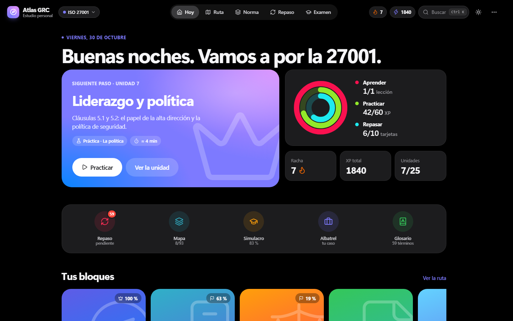
</p>

Empezar en GRC leyendo directamente una norma suele acabar igual: memorizar cláusulas sin entender cómo se convierten en documentos, controles y decisiones reales. **Atlas** ordena el aprendizaje en un recorrido corto y práctico:

- **25 unidades** en 6 bloques (fundamentos y cláusulas 4 a 9), cada una con lección, prácticas y un jefe final;
- **mapa de la norma** con las cláusulas por el ciclo PDCA y los **93 controles** del Anexo A explicados en lenguaje sencillo;
- **caso Albatrel**: una empresa inventada con su SGSI completo en **14 documentos propios**, que se leen, se descargan y se **construyen paso a paso**;
- **simulacro** con el formato del examen ISO/IEC 27001 Foundation de CertiProf (40 preguntas, 60 minutos) y un banco de **247 preguntas propias**;
- **repaso espaciado** del glosario y de los errores, para que lo aprendido se quede.

Funciona en el navegador, sin servidor, sin cuentas y sin conexión. Tu progreso no sale de tu equipo.

<div align="center">

## `$ cat atlas.yaml`

<table>
  <thead>
    <tr>
      <th colspan="2" align="left"><code>atlas:~$ cat atlas.yaml</code></th>
    </tr>
  </thead>
  <tbody>
    <tr>
      <td width="50%" valign="top"><code>├─ ⚖ normas:</code><br><br>
        
        
        <br>
        <sub><code>cláusulas 4–9 · 93 controles · CertiProf I27001F · ENS, ISO 27005, 22301, 19011 y 27701 en la hoja de ruta</code></sub>
      </td>
      <td width="50%" valign="top"><code>├─ ▣ contenido:</code><br><br>
        
        
        <br>
        <sub><code>6 bloques · 59 términos · 10 riesgos · SoA de 93 controles · 14 acciones de tratamiento</code></sub>
      </td>
    </tr>
    <tr>
      <td valign="top"><code>├─ ✦ aplicacion:</code><br><br>
        
        
        
        <br>
        <sub><code>JavaScript sin dependencias · HTML · CSS · iconos Lucide · View Transitions</code></sub>
      </td>
      <td valign="top"><code>├─ ⚙ build_ci_cd:</code><br><br>
        
        
        <br>
        <sub><code>sin build · GitHub Pages publica la rama main en cada push</code></sub>
      </td>
    </tr>
    <tr>
      <td valign="top"><code>├─ ◉ diseño:</code><br><br>
        
        <br>
        <sub><code>claro y oscuro · índigo y coral · Sonner · Vaul · respeta «reducir movimiento»</code></sub>
      </td>
      <td valign="top"><code>╰─ ⌁ privacidad:</code><br><br>
        
        
        <br>
        <sub><code>progreso en localStorage · copia de seguridad en JSON · cero peticiones a terceros</code></sub>
      </td>
    </tr>
  </tbody>
  <tfoot>
    <tr>
      <td colspan="2"><code>version: 0.5 beta&nbsp;&nbsp;·&nbsp;&nbsp;ISO/IEC 27001:2022&nbsp;&nbsp;·&nbsp;&nbsp;bloques: 0–5 de 10&nbsp;&nbsp;·&nbsp;&nbsp;caso: Albatrel (ficticio)</code></td>
    </tr>
  </tfoot>
</table>

</div>

---

## Índice

- [Cómo se usa](#-cómo-se-usa)
- [Mapa mental](#-mapa-mental)
- [Vistas](#-vistas)
- [Capturas](#-capturas)
- [El caso Albatrel](#-el-caso-albatrel)
- [Arranque rápido](#-arranque-rápido)
- [Arquitectura](#-arquitectura)
- [Contenido y derechos de autor](#-contenido-y-derechos-de-autor)
- [Hoja de ruta](#-hoja-de-ruta)
- [Limitaciones conocidas](#-limitaciones-conocidas)
- [Estructura](#-estructura)
- [Licencia](#-licencia)
- [Autor](#-autor)

---

##  Cómo se usa

1. **Tu plan.** Tres preguntas al entrar: objetivo (aprobar CertiProf, aprender desde cero o prepararte para auditar), nivel y minutos al día. Atlas decide desde qué bloque empiezas y tu meta diaria.
2. **Cada unidad, en tres pasos.** Una lección en tarjetas cortas con preguntas rápidas, prácticas con ejercicios variados (bandera azul con un 70 %, dorada con un 100 %) y un jefe final con 3 vidas y 30 segundos por pregunta.
3. **Aterrizar en Albatrel.** Cada concepto se aplica a la misma empresa ficticia y puedes construir sus documentos paso a paso.
4. **Repasar.** Las tarjetas del glosario vuelven a los 1, 3, 7, 14 y 30 días; los errores, a los 1, 3 y 7 días hasta acertarlos tres veces.
5. **Ponerte a prueba.** Simulacros de 10, 20 o 40 preguntas con revisión de cada respuesta; los fallos pasan al repaso.

##  Mapa mental

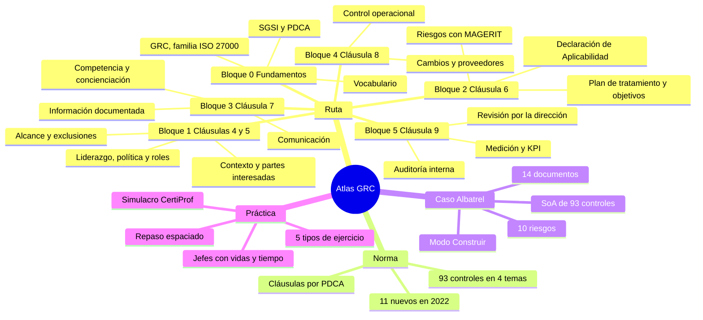

##  Vistas

| | Vista | Contenido |
|---|---|---|
|  | **Hoy** | Siguiente paso recomendado, anillos de actividad (aprender, practicar y repasar), racha, XP, accesos rápidos y carrusel de bloques. |
|  | **Ruta y bloques** | Los 11 bloques previstos; cada bloque activo con su cabecera, progreso y unidades. |
|  | **Unidad** | Lección, prácticas y jefe. Ejercicios de elegir, verdadero o falso, emparejar, ordenar y clasificar, con corrección en una hoja inferior y la fuente de cada idea. |
|  | **Mapa de la norma** | Cláusulas 4 a 10 ordenadas por el ciclo PDCA y los 93 controles con buscador, filtros por tema, los 11 nuevos de 2022 y la opción de marcarlos como entendidos. |
|  | **Caso Albatrel** | La empresa, su pirámide documental y sus 14 documentos para leer, descargar en Markdown o construir paso a paso. |
|  | **Simulacro** | 10, 20 o 40 preguntas con temporizador, marcadores, entrega manteniendo pulsado y revisión completa. |
|  | **Repaso y glosario** | 59 términos con tarjetas que se giran y la sesión de «Mis errores». |

También incluye buscador global (`Ctrl + K`), progreso con calendario de constancia e insignias, temas claro y oscuro en índigo o coral, copia de seguridad del progreso, versión móvil y un **modo demostración** con progreso de ejemplo: [`?demo`](https://heindall92.github.io/atlas-grc/?demo).

##  Capturas

<table>
<tr>
<td width="50%">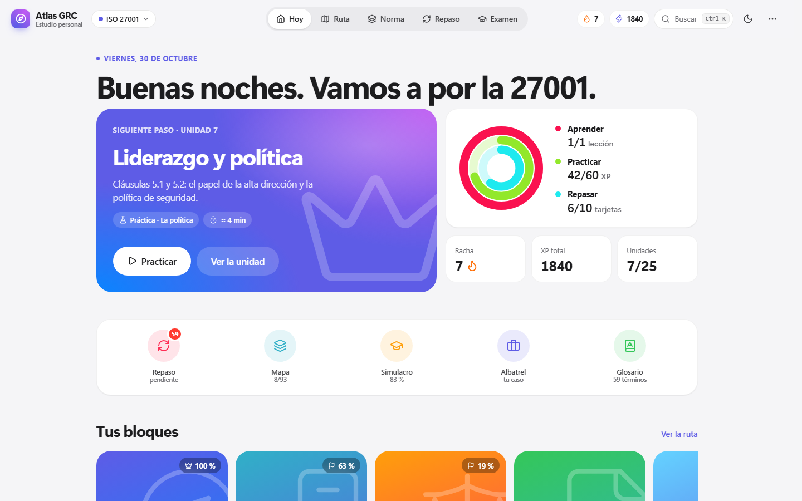<br/><sub><b>Hoy</b> · siguiente paso, anillos y accesos rápidos</sub></td>
<td width="50%">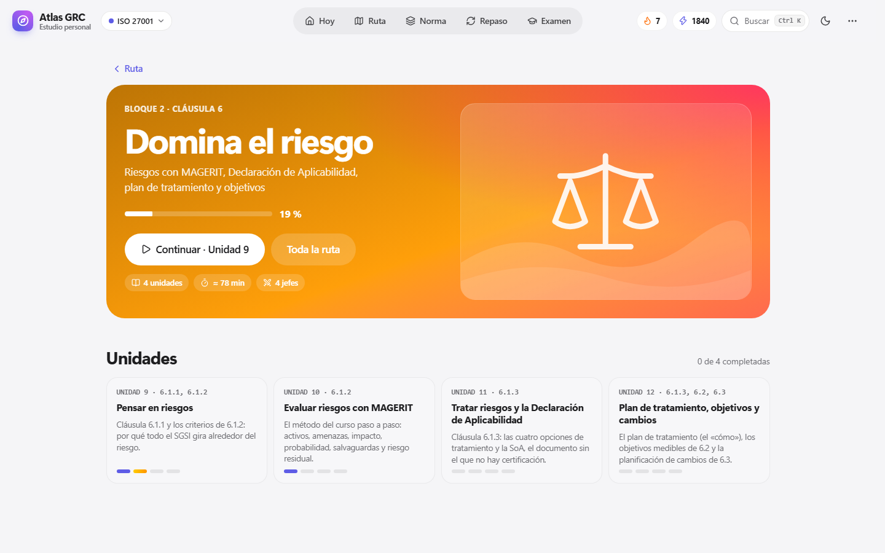<br/><sub><b>Bloque 2</b> · «Domina el riesgo», con progreso y unidades</sub></td>
</tr>
<tr>
<td>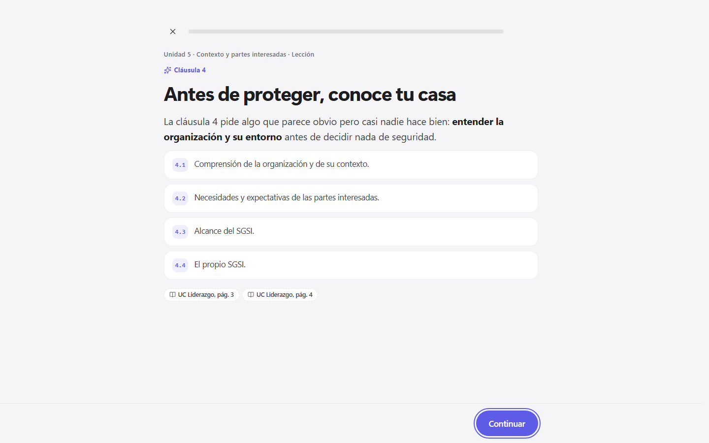<br/><sub><b>Lección</b> · una idea por tarjeta, con su fuente</sub></td>
<td>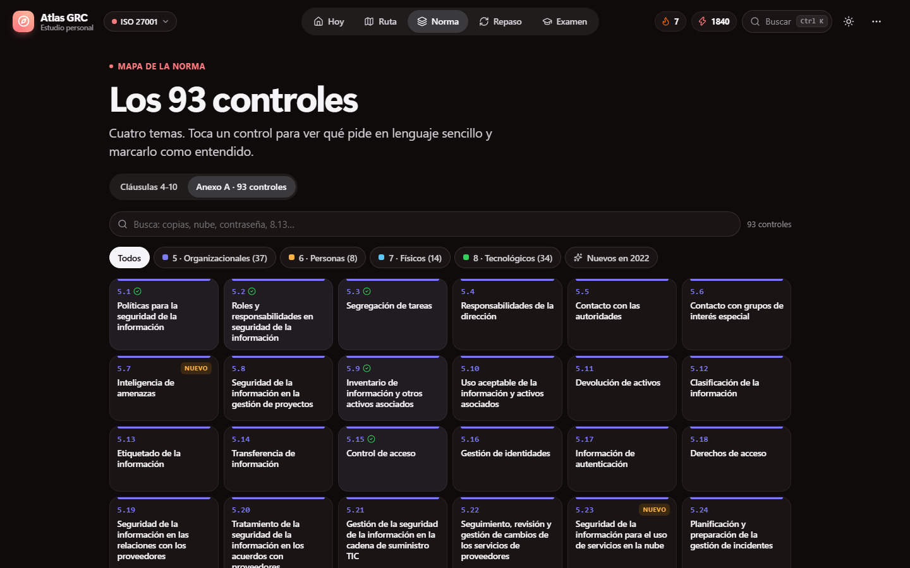<br/><sub><b>Mapa de la norma</b> · los 93 controles en 4 temas</sub></td>
</tr>
<tr>
<td>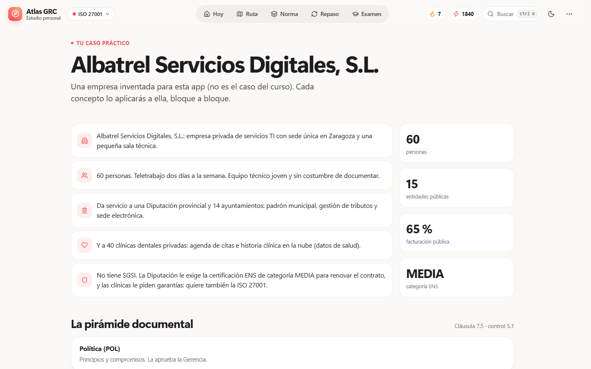<br/><sub><b>Caso Albatrel</b> · la empresa ficticia del laboratorio</sub></td>
<td>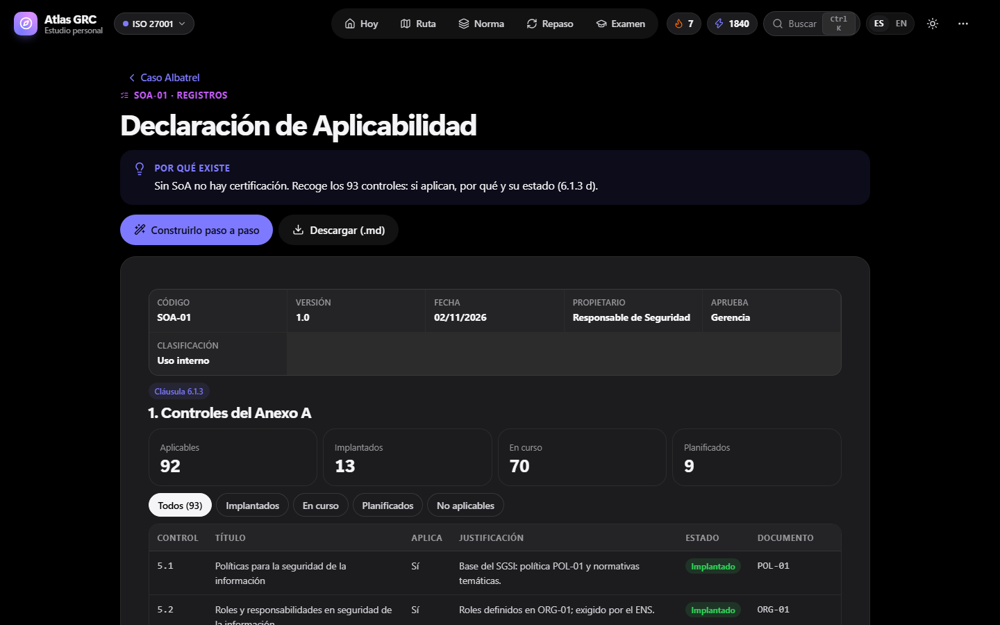<br/><sub><b>SOA-01</b> · Declaración de Aplicabilidad de los 93 controles</sub></td>
</tr>
<tr>
<td>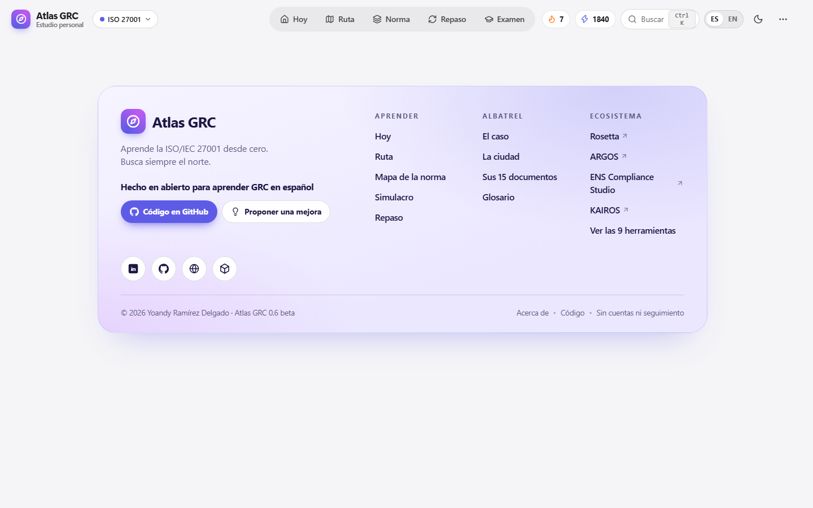<br/><sub><b>DOC-01</b> · contexto, partes interesadas y alcance</sub></td>
<td>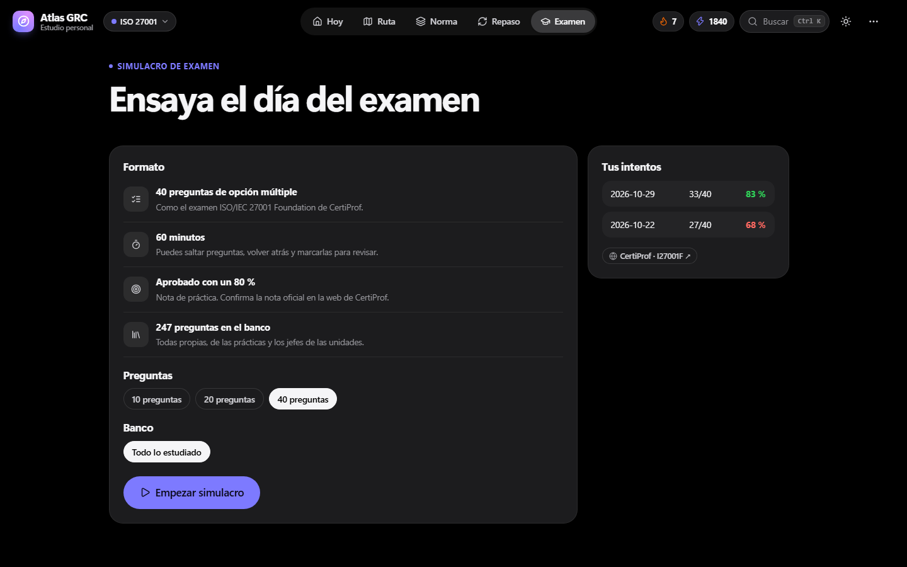<br/><sub><b>Simulacro</b> · formato CertiProf e historial de intentos</sub></td>
</tr>
</table>

<p align="center">
  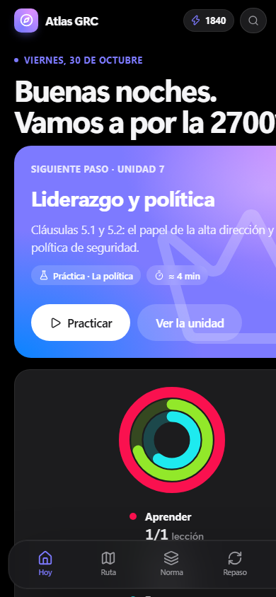
  &nbsp;&nbsp;
  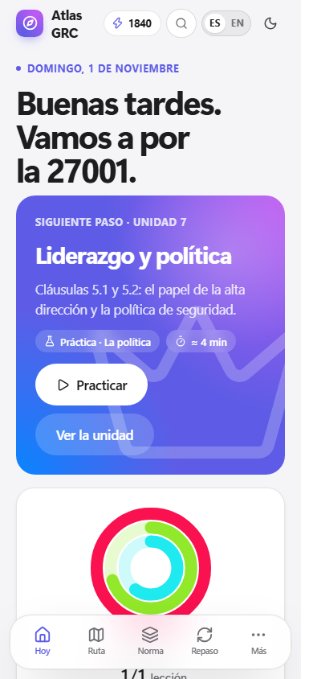
</p>

##  El caso Albatrel

**Albatrel Servicios Digitales, S.L.** es una empresa inventada para este laboratorio: 60 personas en Zaragoza que dan servicio de padrón, tributos y sede electrónica a una Diputación y 14 ayuntamientos, y un servicio en la nube de agenda e historia clínica a 40 clínicas dentales. La Diputación le exige el ENS de categoría MEDIA y quiere certificarse también en ISO/IEC 27001.

| Nivel | Documentos |
|---|---|
| Política | POL-01 Política de seguridad de la información |
| Documentos del sistema | DOC-01 Contexto, partes interesadas y alcance · ORG-01 Roles y RACI · MET-01 Metodología de riesgos (MAGERIT) · OBJ-01 Objetivos · PLN-01 Competencia, concienciación y comunicación |
| Normativas | NOR-01 Control de accesos · NOR-02 Copias de seguridad · NOR-03 Uso aceptable y teletrabajo |
| Procedimientos | PRO-01 Gestión de incidentes · PRO-02 Gestión documental |
| Registros | REG-01 Análisis de riesgos (10 riesgos) · SOA-01 Declaración de Aplicabilidad (93 controles justificados) · PTR-01 Plan de tratamiento (14 acciones) |

En el modo **Construir**, cada sección del documento se decide con un ejercicio y después se muestra ya redactada.

##  Arranque rápido

**En el navegador:** abre [heindall92.github.io/atlas-grc](https://heindall92.github.io/atlas-grc/).

**En tu ordenador** (hace falta Python 3):

```bash
git clone https://github.com/heindall92/atlas-grc.git
cd atlas-grc
python serve.py
```

Se abre `http://127.0.0.1:8643`. En Windows también puedes hacer doble clic en `Iniciar.bat`.

##  Arquitectura

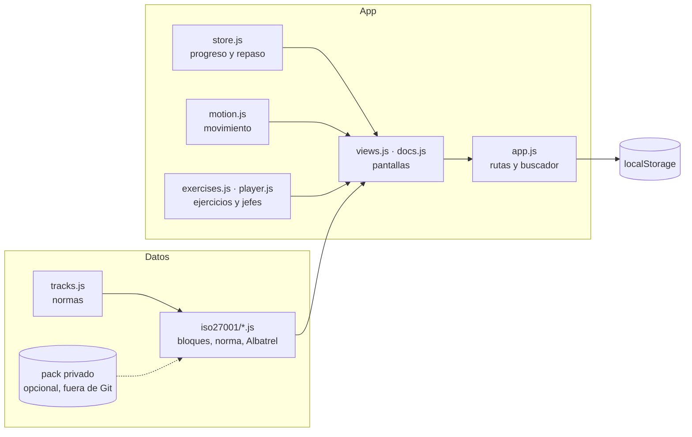

- **Sin dependencias ni build**: HTML, CSS y JavaScript que el navegador carga tal cual.
- **Datos separados de la interfaz**: cada norma es una «pista» en `app/data/tracks.js`, con su color y su progreso. Añadir el ENS u otra ISO es crear su carpeta de datos.
- **Pack privado opcional**: en local se puede conectar material propio (por ejemplo, los PDF de un curso) en `app/data/private/`, que está en `.gitignore` y nunca forma parte de la demo.

##  Contenido y derechos de autor

- **Todo el contenido es propio**: lecciones, ejercicios, explicaciones de los 93 controles, preguntas del simulacro y el caso Albatrel.
- Las **citas** indican de dónde sale cada idea (clases del curso, la norma o una fuente web) para poder ampliarla, sin reproducir su texto.
- De la ISO/IEC 27001 solo se usan los **números y títulos** de cláusulas y controles como referencia. Es una obra protegida de ISO/IEC: consulta tu ejemplar oficial (ISO o UNE).
- Lo que procede de internet está marcado como **«Fuente web»** con su enlace.
- MAGERIT, el ENS y las guías CCN-STIC son publicaciones públicas de la Administración española.
- Inspirado en las clases de GRC del profesor **Ezequiel Wolf**.

##  Hoja de ruta

- [x] Bloques 0 a 5: fundamentos y cláusulas 4 a 9
- [x] Caso Albatrel con 14 documentos y modo Construir
- [x] Bienvenida con plan personal, temas índigo y coral, modo demostración
- [ ] Bloque 6: cláusula 10 (no conformidades y mejora)
- [ ] Bloques 7 a 9: controles del Anexo A en profundidad
- [ ] Bloque 10: auditoría de certificación
- [ ] Ilustraciones por bloque
- [ ] Nuevas pistas: ENS, riesgos con MAGERIT (ISO 27005), continuidad (ISO 22301), auditoría (ISO 19011) y privacidad (ISO 27701)

##  Limitaciones conocidas

- **Beta**: el contenido cubre las cláusulas 4 a 9; el Anexo A en profundidad y la cláusula 10 están en camino.
- El simulacro reproduce el **formato** del examen de CertiProf, no sus preguntas. Confirma la nota de aprobado y las condiciones en la [web oficial](https://certiprof.com/es/pages/certified-iso-iec-27001-2022-foundation-i27001f-spanish).
- El progreso vive en el navegador: si borras sus datos, se pierde. Usa **Ajustes → Guardar copia**.
- No sustituye a la norma ni a un curso oficial: es una herramienta de estudio.

##  Estructura

```
atlas-grc/
│
├── 🧩 app/
│   ├── index.html                Punto de entrada
│   ├── css/atlas.css             Tokens, claro y oscuro, índigo y coral, móvil
│   ├── js/
│   │   ├── store.js              Progreso, XP, racha, repaso espaciado, modo demo
│   │   ├── motion.js             Avisos, hojas, transiciones, anillos, confeti
│   │   ├── exercises.js          Elegir, verdadero o falso, emparejar, ordenar, clasificar
│   │   ├── player.js             Lecciones, prácticas, jefes y simulacro
│   │   ├── views.js              Hoy, ruta, bloques, norma, repaso, progreso, ajustes
│   │   ├── docs.js               Documentos de Albatrel: visor, descarga y modo Construir
│   │   ├── app.js                Cabecera, rutas, buscador y bienvenida
│   │   └── icons.js              Iconos Lucide en línea (ISC)
│   ├── data/
│   │   ├── tracks.js             Registro de normas
│   │   └── iso27001/             content · bloque2 a bloque5 · albatrel · norma
│   └── img/                      Ilustraciones opcionales
│
├── 📄 docs/                      Capturas e iconos del README
├── 🎨 diseno/                    Prompts de las ilustraciones
├── 🛠️ tools/                      extraer.py (MarkItDown, para el pack privado)
├── 🐍 serve.py · Iniciar.bat     Servidor local
└── 🌐 index.html · .nojekyll     Entrada de GitHub Pages (redirige a app/)
```

##  Licencia

© 2026 Yoandy Ramírez Delgado. Licencia pendiente de publicar.

Componentes de terceros: iconos de [Lucide](https://lucide.dev) (ISC, ver `app/js/LICENSE-lucide.txt`). ISO/IEC 27001 es una obra protegida de ISO/IEC; MAGERIT, el ENS y las guías CCN-STIC son publicaciones públicas.

##  Autor

<table>
<tr>
<td align="center" width="100%" valign="top">
<br/>
<b>Yoandy Ramírez Delgado</b><br/>
<sub><b>Diseño y desarrollo de Atlas</b></sub><br/>
<sub>Junior Pentester · eJPTv2 · AI Governance (ISO 42001) · SysAdmin</sub><br/><br/>
<a href="https://www.linkedin.com/in/yoandyrd92/"></a>
<a href="https://github.com/heindall92"></a>
<a href="https://yoandyramirez.com"></a>
<a href="https://profile.hackthebox.com/profile/019c5812-b4ca-7315-b12f-14db6d2b42fa"></a>
</td>
</tr>
</table>

Otras herramientas GRC del autor: [Rosetta](https://github.com/heindall92/rosetta_multinorma) (mapa multinorma y grado de cumplimiento), [ARGOS](https://github.com/heindall92/argos-grc) (laboratorio de práctica con rutas, casos y simulacros), [ENS Compliance Studio](https://github.com/heindall92/grc_ens_compliance_studio) (categorización, riesgos MAGERIT y Declaración de Aplicabilidad) y [KAIROS](https://github.com/heindall92/kairos) (continuidad de negocio: BIA, BCP y DRP).

Errores o propuestas: abre una *issue* o escribe a <a href="mailto:yoandyramirezdelgado@gmail.com">yoandyramirezdelgado@gmail.com</a>.

<p align="center">
  
</p>
